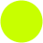

<!-- Generated from palette.json by slack/build.py, do not edit. -->
# Voltaic for Slack

Slack has no theme files. A custom theme is four colours set in the app,
so this README is the whole port.

## Install

1. Open **Preferences > Appearance > Custom theme**.
2. Click **Import** and paste the theme string for your flavour.
3. Set Slack's own light/dark mode to match the flavour.

Or set each colour by hand with the pencil button beside it.

Slack warns that it may adjust imported colours for contrast, but both
strings import unchanged. Untick **Window gradient** to keep the sidebar
a flat `base`.

## Voltaic Dark

Theme string:

```text
#09090B, #C8FF00, #10B981, #F7768E
```

| Slack setting | Colour | Hex |
| --- | --- | --- |
| System navigation | `base` |  `#09090B` |
| Selected items | `volt` |  `#C8FF00` |
| Presence indication | `jade` |  `#10B981` |
| Notifications | `ember` |  `#F7768E` |

## Voltaic Light

Theme string:

```text
#F0EFED, #4C790F, #047857, #BE123C
```

| Slack setting | Colour | Hex |
| --- | --- | --- |
| System navigation | `base` |  `#F0EFED` |
| Selected items | `volt` |  `#4C790F` |
| Presence indication | `jade` |  `#047857` |
| Notifications | `ember` |  `#BE123C` |

## Mapping

- **System navigation is `base`**, the application background in the
  [style guide](../docs/style-guide.md).
- **Selected items is `volt`**, the focus and active-state colour.
- **Presence is `jade`**, because being online is a success state.
- **Notifications is `ember`**, so unread badges read as needing attention.

## Customising

Do not edit this README. It is generated from
[`palette.json`](../palette.json) by [`build.py`](build.py), and `check.py`
fails if the two disagree. Change the palette and run `./build.py` from the
repository root.
